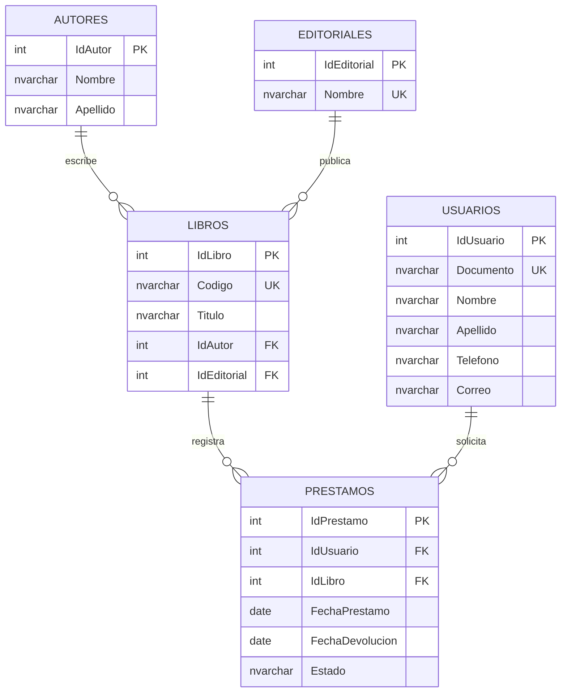
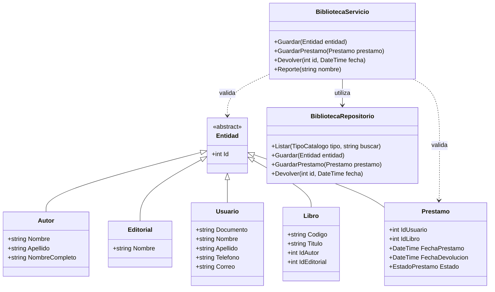

# Sistema de gestión de biblioteca

**Autora:** Wendy Katheryn Sarmiento Guevara  
**Programa:** Ingeniería de Sistemas  
**Institución:** Corporación Unificada Nacional de Educación Superior - CUN  
**Asignatura:** Programación Avanzada  
**Fecha:** 7 de noviembre de 2026

---

## Contraportada

Trabajo académico sobre una aplicación de escritorio para organizar los registros de una biblioteca. Se emplean C#, Windows Forms y SQL Server.

**Estudiante:** Wendy Katheryn Sarmiento Guevara  
**Docente:** [completar nombre]  
**Tipo de entrega:** Proyecto final de Programación Avanzada.

**Estado de las evidencias:** El documento describe el código incluido. Las capturas y los resultados de pruebas funcionales deben completarse después de ejecutar la aplicación en Windows con SQL Server. No se presentan pruebas pendientes como aprobadas.

## Tabla de contenido

1. Introducción
2. Objetivos
3. Planteamiento del problema
4. Requerimientos
5. Casos de uso
6. Modelo entidad-relación
7. Diccionario de datos
8. Diagrama de clases y POO
9. Arquitectura del sistema
10. Módulos desarrollados
11. Conexión con SQL Server
12. Validaciones
13. Capturas de pantalla
14. Pruebas de funcionamiento
15. Control de versiones
16. Conclusiones
17. Recomendaciones
18. Referencias

La numeración de páginas corresponde a la copia PDF que se genere a partir de este documento. El archivo Markdown se conserva como documento fuente solicitado por la guía.

## 1. Introducción

Una biblioteca necesita tener organizada la información de sus libros y de las personas que los solicitan. Cuando estos registros se llevan por separado, puede ser difícil conocer quién tiene un libro o si ya fue devuelto.

Este proyecto propone una aplicación de escritorio que reúne autores, editoriales, usuarios, libros y préstamos en una base de datos. La aplicación permite guardar, consultar, editar y eliminar registros, además de registrar devoluciones y consultar reportes.

La solución utiliza C# con Windows Forms para las ventanas y SQL Server para almacenar la información. El código se organiza por responsabilidades para facilitar su comprensión y mantenimiento.

## 2. Objetivos

### Objetivo general

Desarrollar una aplicación de escritorio para gestionar la información de una biblioteca mediante C#, Windows Forms y SQL Server, aplicando conceptos de programación orientada a objetos.

### Objetivos específicos

- Diseñar una base de datos con relaciones y restricciones de integridad.
- Implementar operaciones de registro, consulta, edición y eliminación de información.
- Gestionar préstamos y devoluciones con estados y fechas coherentes.
- Separar presentación, reglas de negocio y acceso a datos.
- Validar la información y presentar mensajes comprensibles.
- Documentar el sistema y utilizar Git y GitHub para el control de versiones.

## 3. Planteamiento del problema

Una institución educativa necesita una forma centralizada de administrar su biblioteca. Requiere identificar los libros, relacionarlos con sus autores y editoriales y conocer el usuario responsable de cada préstamo. También necesita registrar devoluciones y consultar información consolidada.

El alcance incluye una aplicación local de escritorio, cinco tablas principales y reportes en pantalla. Cada fila de Libros representa un ejemplar con un código único. Un préstamo registra un usuario y un ejemplar. El modelo admite un autor y una editorial por libro.

No se incluyen multas, reservas, autenticación de usuarios de la biblioteca, exportación de reportes ni relaciones de varios autores por libro. La ventana inicial autentica la conexión con SQL Server; no es un módulo de acceso de usuarios bibliotecarios.

## 4. Requerimientos

| Código | Requerimiento | Implementación |
|---|---|---|
| RF01 | Gestionar y buscar libros. | Alta, consulta, edición, eliminación y búsqueda por código, título o autor. |
| RF02 | Gestionar autores. | Nombre, apellido y operaciones CRUD. |
| RF03 | Gestionar editoriales. | Nombre único y operaciones CRUD. |
| RF04 | Gestionar usuarios. | Documento, nombre, apellido, teléfono y correo. |
| RF05 | Gestionar préstamos. | Selección de usuario y libro; fechas, estado, consulta, edición y eliminación. |
| RF06 | Registrar devoluciones. | Cambio a Devuelto y registro de fecha; se libera la disponibilidad calculada. |
| RF07 | Consultar reportes. | Resumen, catálogos y préstamos totales, activos o devueltos. |
| RF08 | Navegar entre módulos. | Menú principal con Inicio y acceso a los módulos. |

La guía titula RF03 como Gestión de Categorías, pero su contenido describe editoriales. En este proyecto se implementan Editoriales, coherentemente con el alcance y las tablas mínimas.

Los requerimientos no funcionales incluyen una interfaz organizada, validaciones previas al guardado, consultas parametrizadas, manejo de excepciones, mensajes de confirmación y error, nombres descriptivos y separación de responsabilidades.

## 5. Casos de uso

Actor principal: persona encargada de la biblioteca.

| Caso | Condición previa | Pasos principales | Resultado o alternativa |
|---|---|---|---|
| CU01 Registrar autor | Conexión activa. | Abrir Autores, Nuevo, escribir nombre y apellido, Guardar. | Autor registrado; si falta un campo, se solicita completarlo. |
| CU02 Registrar editorial | Conexión activa. | Abrir Editoriales, Nuevo, escribir nombre, Guardar. | Editorial registrada; se impide un nombre duplicado. |
| CU03 Registrar usuario | Conexión activa. | Completar documento, nombre y apellido; agregar contacto si aplica. | Usuario registrado; se rechaza documento duplicado o correo inválido. |
| CU04 Registrar libro | Autor y editorial existentes. | Escribir código y título, seleccionar relaciones y guardar. | Libro registrado; se rechaza código duplicado o referencias inexistentes. |
| CU05 Registrar préstamo | Usuario existente y ejemplar disponible. | Seleccionar usuario y libro, elegir fecha, dejar Prestado y devolución sin marcar. | Préstamo activo; si el ejemplar ya está prestado, se rechaza. |
| CU06 Registrar devolución | Préstamo activo seleccionado. | Pulsar Devolver hoy, o editar estado y fecha de devolución. | Estado Devuelto, fecha registrada y ejemplar disponible. |
| CU07 Editar registro | Registro seleccionado. | Modificar campos y pulsar Guardar. | Registro actualizado si pasa las validaciones. |
| CU08 Eliminar registro | Registro seleccionado. | Pulsar Eliminar y confirmar. | Se elimina si las relaciones lo permiten; de lo contrario se informa la restricción. |
| CU09 Consultar reportes | Registros disponibles. | Abrir Reportes, elegir consulta y pulsar Consultar. | Resultados en una tabla de solo lectura. |

## 6. Modelo entidad-relación



Un autor, editorial, usuario o libro puede existir sin registros dependientes. Cada libro debe tener un autor y una editorial; cada préstamo debe tener un usuario y un libro. Un libro puede tener muchos préstamos históricos, pero solo uno activo a la vez.

## 7. Diccionario de datos

Todos los identificadores primarios son INT IDENTITY(1,1), obligatorios y generados por SQL Server. NVARCHAR permite almacenar caracteres como tildes y ñ. No hay eliminaciones en cascada.

| Tabla | Campo | Tipo SQL | Obligatorio | Clave o regla |
|---|---|---|---|---|
| Autores | IdAutor | INT | Sí | PK, IDENTITY. |
| Autores | Nombre | NVARCHAR(80) | Sí | Texto no vacío. |
| Autores | Apellido | NVARCHAR(80) | Sí | Texto no vacío. |
| Editoriales | IdEditorial | INT | Sí | PK, IDENTITY. |
| Editoriales | Nombre | NVARCHAR(120) | Sí | UNIQUE, texto no vacío. |
| Usuarios | IdUsuario | INT | Sí | PK, IDENTITY. |
| Usuarios | Documento | NVARCHAR(30) | Sí | UNIQUE, texto no vacío. |
| Usuarios | Nombre | NVARCHAR(80) | Sí | Texto no vacío. |
| Usuarios | Apellido | NVARCHAR(80) | Sí | Texto no vacío. |
| Usuarios | Telefono | NVARCHAR(30) | No | NULL cuando está vacío. |
| Usuarios | Correo | NVARCHAR(150) | No | NULL si está vacío; formato validado en C#. |
| Libros | IdLibro | INT | Sí | PK, IDENTITY. |
| Libros | Codigo | NVARCHAR(30) | Sí | UNIQUE, identifica un ejemplar. |
| Libros | Titulo | NVARCHAR(180) | Sí | Texto no vacío. |
| Libros | IdAutor | INT | Sí | FK a Autores.IdAutor. |
| Libros | IdEditorial | INT | Sí | FK a Editoriales.IdEditorial. |
| Prestamos | IdPrestamo | INT | Sí | PK, IDENTITY. |
| Prestamos | IdUsuario | INT | Sí | FK a Usuarios.IdUsuario. |
| Prestamos | IdLibro | INT | Sí | FK a Libros.IdLibro. |
| Prestamos | FechaPrestamo | DATE | Sí | Fecha real del préstamo. |
| Prestamos | FechaDevolucion | DATE | No | NULL mientras está prestado; obligatoria si está devuelto. |
| Prestamos | Estado | NVARCHAR(10) | Sí | Prestado o Devuelto; valor inicial Prestado. |

El índice filtrado `UX_Prestamos_LibroActivo` impide dos filas Prestado para el mismo IdLibro. Los CHECK de préstamos validan los estados, la secuencia de fechas y la correspondencia entre el estado y la devolución.

## 8. Diagrama de clases y POO



FechaDevolucion es nullable en C# (`DateTime?`) y en SQL Server. Telefono y Correo también son opcionales. La propiedad Id de cada entidad se corresponde con la clave específica de su tabla, por ejemplo Libro.Id con Libros.IdLibro.

Los constructores permiten crear los objetos con los datos necesarios. Las propiedades representan sus atributos. La clase abstracta Entidad comparte el identificador de los registros y sus clases derivadas agregan los atributos específicos. El servicio recibe objetos, valida los datos y llama al repositorio.

El encapsulamiento se observa en los campos privados de conexión y repositorio, y en CadenaConexion, que tiene escritura privada. Las colecciones se utilizan en listas de parámetros y diccionarios de controles. La clase Campo y Catalogos permiten reutilizar el formulario de catálogos. No se añade polimorfismo de comportamiento como bonificación.

## 9. Arquitectura del sistema

| Capa | Ubicación | Responsabilidad |
|---|---|---|
| Presentación | Biblioteca/Presentacion | Formularios, captura de datos, selección de registros y mensajes. |
| Negocio | Biblioteca/Negocio | Campos obligatorios, longitudes, correo, relaciones y coherencia de préstamos. |
| Datos | Biblioteca/Datos | Conexión, consultas parametrizadas y transacciones. |
| Entidades | Biblioteca/Entidades | Clases compartidas entre formularios, servicio y repositorio. |
| Base de datos | SQL Server, BibliotecaACA | Persistencia, claves, restricciones e índice de disponibilidad. |

Las capas están separadas por carpetas y clases dentro de un proyecto de Visual Studio. Los formularios de gestión llaman al servicio, y este llama al repositorio. La ventana de conexión utiliza el repositorio para comprobar que la base existe y tiene las tablas necesarias.

## 10. Módulos desarrollados

| Módulo | Clase de presentación | Funcionamiento |
|---|---|---|
| Conexión | FrmConexion | Captura servidor, base y autenticación. Comprueba acceso antes de abrir Inicio. |
| Inicio | FrmPrincipal | Menú y resumen de cantidades. |
| Autores | FrmCatalogo con TipoCatalogo.Autores | CRUD y búsqueda por nombre o apellido. |
| Editoriales | FrmCatalogo con TipoCatalogo.Editoriales | CRUD y búsqueda por nombre. |
| Usuarios | FrmCatalogo con TipoCatalogo.Usuarios | CRUD y búsqueda por documento o nombre. |
| Libros | FrmCatalogo con TipoCatalogo.Libros | CRUD, selección de relaciones, búsqueda y disponibilidad calculada. |
| Préstamos y devoluciones | FrmPrestamos | CRUD, búsqueda y devolución del ejemplar. |
| Reportes | FrmReportes | Ocho consultas en pantalla, sin exportación. |

Nuevo limpia los campos y prepara una inserción. Seleccionar una fila carga sus valores para edición. Guardar decide insertar o actualizar según el identificador. Eliminar solicita confirmación. Actualizar recarga los datos desde SQL Server.

La devolución actualiza una sola fila con una sentencia SQL condicionada al estado activo. La disponibilidad del libro se consulta a partir de los préstamos, por lo que no hay un contador separado que deba actualizarse. Si se elimina un préstamo activo, el ejemplar vuelve a figurar disponible al consultar; esta eliminación es una corrección administrativa confirmada por el usuario.

## 11. Conexión con SQL Server

Se utiliza Microsoft.Data.SqlClient mediante un paquete NuGet. La ventana inicial construye la cadena de conexión con SqlConnectionStringBuilder. Admite autenticación de Windows o usuario SQL. Las credenciales ingresadas permanecen en memoria durante la ejecución.

Ejemplo para LocalDB:

```text
Server=(localdb)\MSSQLLocalDB;Database=BibliotecaACA;Integrated Security=True;Encrypt=True;TrustServerCertificate=True;
```

El servidor se cambia por la instancia real del equipo. TrustServerCertificate=True facilita la conexión al SQL Server local de este ejercicio; para un despliegue fuera del entorno local se debe configurar la validación de certificados apropiada.

Las consultas reciben valores mediante parámetros con tipo y longitud definidos, como @id, @buscar y @Documento. Los nombres de tablas y columnas provienen de opciones internas controladas por el código. Las conexiones y los comandos se liberan mediante using.

El registro y la edición de préstamos se ejecutan en una transacción Serializable. Se bloquea el ejemplar mientras se comprueba su préstamo activo y se guarda el cambio. Si falla la operación, la transacción no confirmada se revierte al liberarse.

## 12. Validaciones

- Campos obligatorios y longitudes coincidentes con el diccionario.
- Documento, código y nombre de editorial únicos mediante restricciones SQL.
- Correo opcional validado cuando se proporciona.
- Autor, editorial, usuario y libro existentes antes de guardar las relaciones.
- Fechas de préstamo y devolución sin valores futuros en las operaciones de la aplicación.
- Devolución igual o posterior al préstamo; estado consistente con la fecha.
- Un solo préstamo activo por ejemplar.
- Eliminación de registros relacionados impedida por claves foráneas.
- Selección de una fila antes de devolver o eliminar.
- Excepciones capturadas y mensajes para duplicados, relaciones y problemas de conexión.

## 13. Capturas de pantalla

Las siguientes evidencias se deben obtener al ejecutar el sistema. Aún no se han adjuntado capturas de un equipo Windows.

| Archivo en docs/capturas | Evidencia requerida |
|---|---|
| 01_inicio.png | Menú y resumen. |
| 02_autores.png | Listado y campos del módulo. |
| 03_editoriales.png | Listado y campos del módulo. |
| 04_usuarios.png | Datos registrados. |
| 05_libros.png | Libro con autor, editorial y disponibilidad. |
| 06_prestamo.png | Préstamo activo registrado. |
| 07_devolucion.png | Mismo préstamo devuelto y con fecha. |
| 08_reportes.png | Reporte consultado. |
| 09_validacion.png | Mensaje ante un dato inválido. |

Después de guardar cada captura, insértala en este documento con Markdown. Ejemplo: ``.

## 14. Pruebas de funcionamiento

Ejecutar sobre los datos de prueba. Completar Resultado y Evidencia únicamente después de comprobar el comportamiento.

| ID | Acción | Resultado esperado | Resultado obtenido |
|---|---|---|---|
| P01 | Ejecutar 01_Biblioteca.sql en base nueva. | Cinco tablas; 2 autores, 2 editoriales, 2 usuarios, 3 libros y 2 préstamos. | Pendiente de ejecución en SQL Server. |
| P02 | Repetir el script sin modificar los datos. | No se duplican los datos de prueba. | Pendiente. |
| P03 | Conectar desde la aplicación. | Aparece Inicio con el resumen. | Pendiente. |
| P04 | Crear y editar un autor, editorial, usuario y libro. | Los cambios aparecen en el listado y permanecen tras reabrir. | Pendiente. |
| P05 | Guardar un usuario con documento PRUEBA-001. | Mensaje de duplicidad. | Pendiente. |
| P06 | Guardar un libro con código BIB-001. | Mensaje de duplicidad. | Pendiente. |
| P07 | Guardar un autor sin nombre. | Se solicita el campo obligatorio. | Pendiente. |
| P08 | Guardar usuario con correo abc. | Se solicita un correo válido. | Pendiente. |
| P09 | Buscar libro por BIB-003 o parte del título. | Solo aparecen coincidencias. | Pendiente. |
| P10 | Prestar BIB-003 a un usuario existente. | Préstamo activo; libro Prestado. | Pendiente. |
| P11 | Registrar otro préstamo activo de BIB-003. | Operación impedida; el original permanece. | Pendiente. |
| P12 | Seleccionar préstamo activo de BIB-003 y Devolver hoy. | Estado Devuelto, fecha actual y libro Disponible. | Pendiente. |
| P13 | Pulsar otra vez Devolver hoy sobre ese préstamo. | Se informa que ya fue devuelto; no se altera la fecha. | Pendiente. |
| P14 | Editar un préstamo con devolución anterior al préstamo. | Operación impedida. | Pendiente. |
| P15 | Eliminar un autor asociado a libros. | Se impide eliminar por integridad referencial. | Pendiente. |
| P16 | Crear y eliminar un autor sin relaciones. | Se elimina después de confirmar. | Pendiente. |
| P17 | Editar y eliminar un préstamo de prueba. | Se aplican los cambios válidos y la eliminación confirmada. | Pendiente. |
| P18 | Consultar reportes activos y devueltos. | Las filas corresponden al estado elegido. | Pendiente. |
| P19 | Ejecutar controles de 02_Consultas_Verificacion.sql. | Las dos consultas de inconsistencias devuelven cero filas. | Pendiente. |

La validación de compilación se registra por separado en ../VALIDACION.md. Compilar no reemplaza ejecutar las pruebas con SQL Server.

## 15. Control de versiones

Se incluye un archivo .gitignore y las instrucciones de Git en README.md. El estudiante debe iniciar el repositorio, registrar commits descriptivos durante sus cambios, agregar capturas y publicar en su cuenta GitHub. No se ha creado ni publicado un repositorio remoto desde este paquete.

**URL del repositorio:** [completar después de publicar].  
**Evidencia de commits:** [adjuntar captura o referenciar historial real].

## 16. Conclusiones

El proyecto reúne la información principal de una biblioteca en cinco tablas relacionadas. La separación entre formularios, validaciones y consultas permite ubicar la responsabilidad de cada parte del código.

Las claves y restricciones ayudan a prevenir registros duplicados y relaciones incompletas. El control de estado y fechas permite representar el préstamo y la devolución de un ejemplar. La comprobación final del funcionamiento requiere completar las pruebas y evidencias en Windows.

## 17. Recomendaciones

Completar la matriz de pruebas y las capturas antes de entregar. Mantener el script, la documentación y los diagramas alineados con cualquier cambio al modelo. Realizar copias de seguridad si se usa información real. En futuras versiones se pueden agregar reservas, varios autores por libro, perfiles de acceso, exportación y un catálogo de títulos separado de los ejemplares.

## 18. Referencias

Microsoft. (s. f.). *Tutorial: Creación de una aplicación de Windows Forms mediante .NET*. Microsoft Learn. https://learn.microsoft.com/es-es/dotnet/desktop/winforms/get-started/create-app-visual-studio

Microsoft. (s. f.). *SQL Server Express LocalDB*. Microsoft Learn. https://learn.microsoft.com/es-es/sql/database-engine/configure-windows/sql-server-express-localdb

Microsoft. (s. f.). *Instalar, actualizar e implementar Microsoft.Data.SqlClient*. Microsoft Learn. https://learn.microsoft.com/es-es/sql/connect/ado-net/download-microsoft-sqlclient-data-provider

GitHub. (s. f.). *Adding a file to a repository*. GitHub Docs. https://docs.github.com/en/repositories/working-with-files/managing-files/adding-a-file-to-a-repository

*Guía académica Aca - Programación Avanzada: Sistema de gestión de biblioteca*. (2026). [Material de clase suministrado para la actividad].
